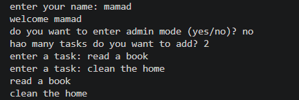
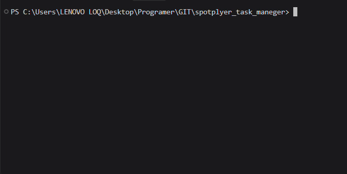

# Personal Task Manager


A simple task manager built with python 

## Features
- add multiple tasks
- save tasks
- load save tasks
- admin mode

## Requirements
- Python 
- python-dotenv

## Project structure
```text
Spotplayer_task_mager/
│   .env.example
│   .gitignore
│   main.py
│   README.md
│   requirements.txt
│   tasks.py
│
├───images/
│       ezgif-speed.gif
│___       spotplayer_task_manager.png

```

## Installition
Install the requirement packages:

```bash
python -m pip install -r requirement
```
## Envoirment setup
create a `.env` file in the project folder 

use `.enve.example` as a template

Add your admin passwort 

```env
admin_password = your_password_here
```
replace `your_password_here` with your own admin password

## Run the program
run the main.py file:
```bash
python main.py
```
## Screenshot


## Demo 
